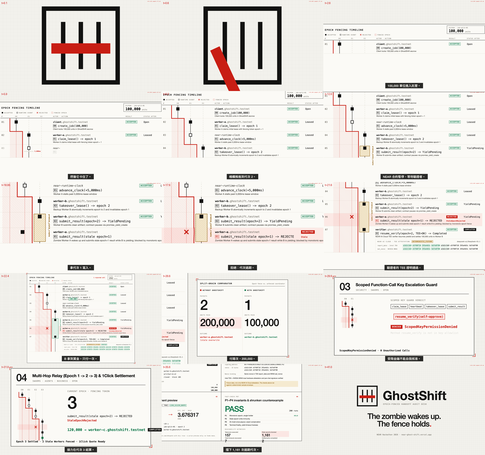
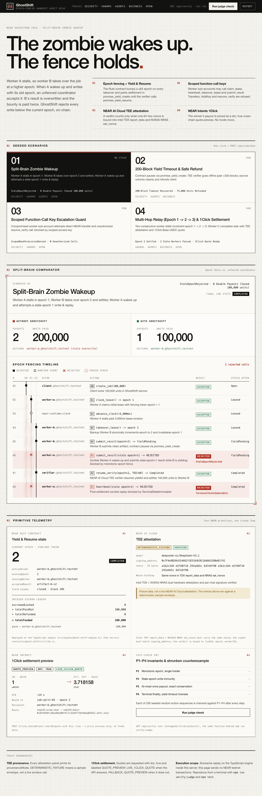
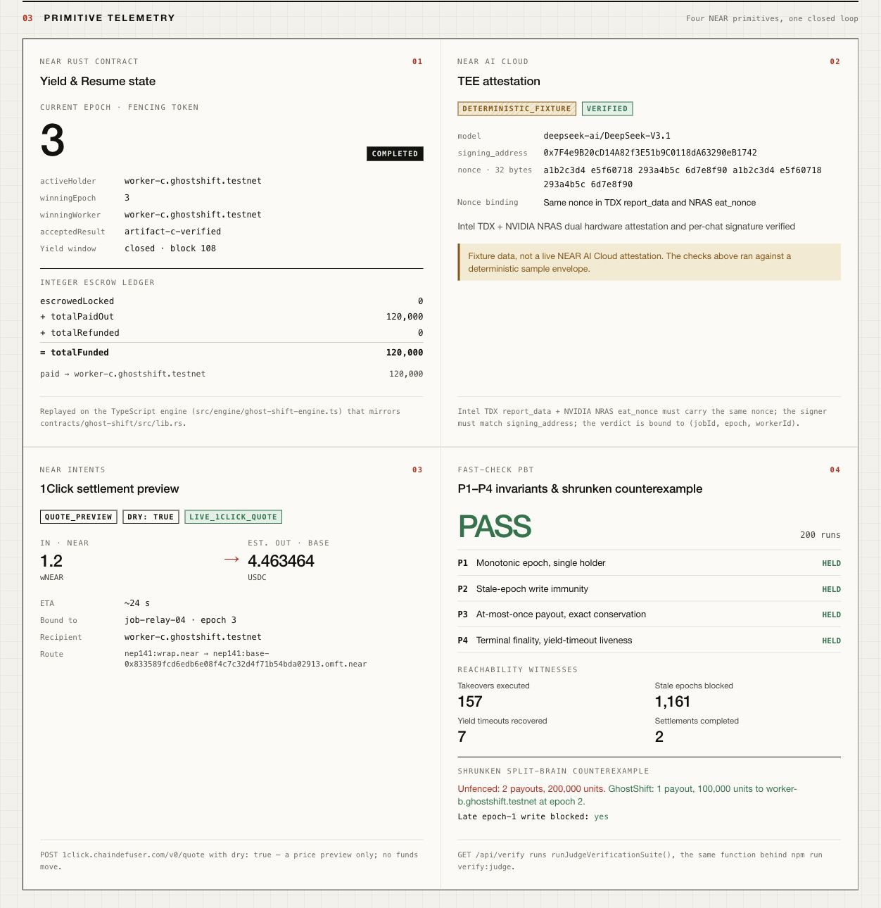

# GhostShift — Monotonic Epoch Fencing & Yield-Resume Handoff Gate on NEAR

[English](/README.md) | [繁體中文](/README.zh-TW.md)

Built for **NEAR Hackathon 2026** (`https://nearhackathon.com/`).

- **Live Interactive Workbench**: [https://near-ghost-shift.vercel.app](https://near-ghost-shift.vercel.app)
- **Public GitHub Repository**: [https://github.com/GGGODLIN/near-ghost-shift](https://github.com/GGGODLIN/near-ghost-shift)
- **Tracks**: `security` (AI Security & Defense), `swarms` (AI Swarms), `agents` (Agent Economy), `business` (Autonomous Business), `open` (Open Innovation), `privacy` (Privacy & Private AI)

https://github.com/user-attachments/assets/b7fae241-3a73-4ec9-8710-123b5c0832e1



---

## The Problem: Split-Brain Zombie Agents Overwriting Active Takeovers

When Agent A (`worker-a.ghostshift.testnet`) stalls mid-task and backup Agent B (`worker-b.ghostshift.testnet`) takes over the expired lease, Agent A often recovers moments later and submits its stale output or replays a settlement callback using a still-valid cryptographic key. Without an on-chain monotonic fencing token (`epoch`) and asynchronous verification gate (`Yield & Resume`), Agent A's late write overwrites Agent B's accepted work or triggers a double payout (`200,000` units paid instead of `100,000`).

## How GhostShift Uses Four Native NEAR Primitives

1. **NEAR Rust Smart Contract ([`contracts/ghost-shift/src/lib.rs`](/contracts/ghost-shift/src/lib.rs), `near-sdk v5.29.0`) with Monotonic `Epoch` Fencing & `Yield & Resume`**:
   - Every `claim_lease` sets `current_epoch = 1`, and every `takeover_lease` after `lease_expires_at_ms` increments `current_epoch += 1`.
   - `submit_result` pauses contract execution for up to 200 blocks via `env::promise_yield_create("on_verify_settled", ...)` while awaiting TEE verification via `env::promise_yield_resume`.
   - Any heartbeat, result submission, or callback carrying `epoch != current_epoch` is deterministically rejected on-chain with `StaleEpochRejected` (or `TerminalStateImmutable` once settled).
2. **Sub-Accounts & Scoped Function-Call Access Keys ([`src/engine/access-key-guard.ts`](/src/engine/access-key-guard.ts))**:
   - Each worker agent (`worker-a.ghostshift.testnet`, `worker-b.ghostshift.testnet`, `worker-c.ghostshift.testnet`) holds a Function-Call Access Key scoped strictly to `coordinator.ghostshift.testnet` and methods `["claim_lease", "heartbeat", "takeover_lease", "submit_result"]` with zero token-transfer permission. Any attempt to call `Transfer`, `AddKey`, or `resume_verify` is blocked with `ScopedKeyPermissionDenied`.
3. **NEAR AI Cloud Hardware-Attested Verification ([`src/verifier/near-ai-tee.ts`](/src/verifier/near-ai-tee.ts))**:
   - Validates the 64-hex-char random `nonce` bound simultaneously inside Intel TDX `report_data` and NVIDIA NRAS `eat_nonce`, verifies that the recovered ECDSA message signer matches `attestation.signing_address`, and binds the verdict to `(jobId, epoch, workerId)`.
4. **NEAR Intents 1Click Cross-Chain Settlement Preview ([`src/intents/oneclick-quote.ts`](/src/intents/oneclick-quote.ts))**:
   - Queries `POST https://1click.chaindefuser.com/v0/quote` with `dry: true` and `swapType: "EXACT_INPUT"` (`nep141:wrap.near` -> Base USDC `nep141:base-0x833589fcd6edb6e08f4c7c32d4f71b54bda02913.omft.near`) for the single winning `(jobId, winningEpoch, winningWorker)`.

---

## Reproducible Judge Steps ("Do X, See Y" — Under 60 Seconds)

### Step 1: Run the 60-Second AI Judge Verification Suite (`Q-017`)
- **Do X**:
  ```bash
  npm install
  npm run verify:judge
  ```
- **See Y**:
  - Completes in ~1 second and prints a JSON report with `"verdict": "PASS"`.
  - Verifies all 9 NEAR Rust `Yield & Resume` contract primitives in `contracts/ghost-shift/src/lib.rs`.
  - Runs 200 randomized state-machine sequences via `fast-check` against an independent event-sourced Oracle (`evaluateGhostShiftOracle`), confirming invariants `P1` (Monotonic Epoch & Single Holder), `P2` (Stale-Epoch Immunity), `P3` (At-Most-Once Payout & Integer Conservation), and `P4` (Terminal Finality & 200-Block Yield-Timeout Liveness), with Reachability Witnesses (`takeoverExecutedCount: 157`, `staleEpochBlockedCount: 1161`, `yieldTimeoutRecoveredCount: 7`, `completedSettlementCount: 2`).
  - Replays the shrunken 6-step split-brain counterexample showing how an unfenced coordinator pays twice (`200,000` units) while `GhostShift` blocks the late `epoch = 1` zombie write (`100,000` units paid once to `worker-b.ghostshift.testnet`).
  - Queries live `https://1click.chaindefuser.com/v0/quote` (`dry: true`, `settlementMode: "QUOTE_PREVIEW"`).

### Step 2: Run the Full Unit, Property-Based & Rust Contract Check Suite
- **Do X**:
  ```bash
  npm test
  RUSTFLAGS="--cfg clippy" cargo check --manifest-path contracts/ghost-shift/Cargo.toml
  ```
- **See Y**:
  - Executes all 3 test files (`tests/ghost-shift-engine.test.ts`, `tests/verifier-and-intents.test.ts`, `tests/api-routes.test.ts`, 17 tests total) and Rust contract typecheck with `0` failures.

### Step 3: Explore the Interactive Audit Workbench
- **Do X**:
  Open [https://near-ghost-shift.vercel.app](https://near-ghost-shift.vercel.app) (or run `npm run dev` and open `http://localhost:3000`).
- **See Y**:
  - Switch across all 4 seeded scenarios (*01. Split-Brain Zombie Wakeup*, *02. 200-Block Yield Timeout & Safe Refund*, *03. Scoped Function-Call Key Escalation Guard*, *04. Multi-Hop Relay & 1Click Settlement*) and click **Run judge check** to inspect the live epoch fencing timeline, TEE attestation badge, `P1..P4` PBT counterexample comparator, and 1Click quote preview card.





---

## Trust & Provenance Boundaries

- **TEE Provenance (`LIVE_TEE` vs `DETERMINISTIC_FIXTURE`)**: When `NEAR_AI_API_KEY` is provided, `resolveTeeAttestationEnvelope` queries `https://cloud-api.near.ai/v1/attestation/report`; when run in zero-secret CI or judge environments without `NEAR_AI_API_KEY`, the verifier evaluates a deterministic cryptographic attestation fixture and explicitly labels `provenanceMode: "DETERMINISTIC_FIXTURE"`.
- **1Click Settlement Mode (`QUOTE_PREVIEW`)**: Per `HACKATHON.md` (`Q-007`, `Q-010`), 1Click quotes are requested with `dry: true` (`settlementMode: "QUOTE_PREVIEW"`, `provenanceMode: "LIVE_1CLICK_QUOTE"` when online or `"FALLBACK_QUOTE_PREVIEW"` when offline) so judges can verify real cross-chain pricing without spending mainnet funds.
- **External Side-Effect Scope**: On-chain epoch fencing guarantees single-writer finality and at-most-once payout within NEAR contracts and epoch-aware consumers; external Web2 APIs that do not inspect fencing tokens must enforce their own idempotency.
