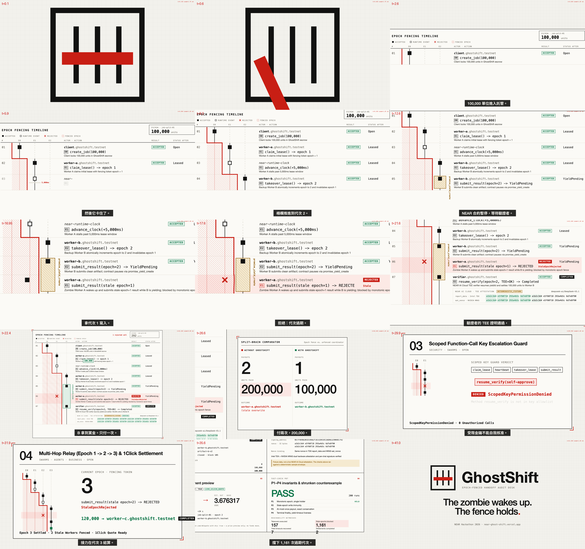
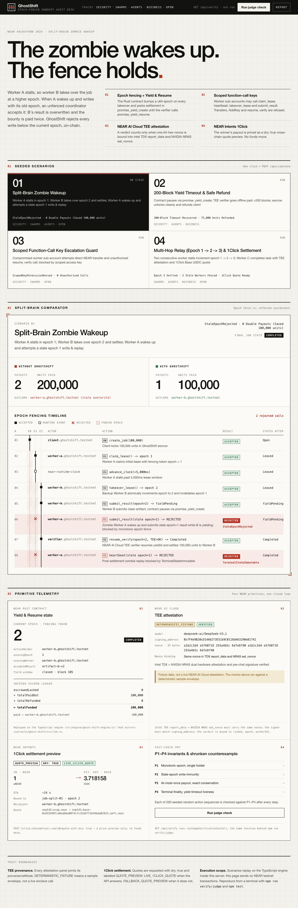
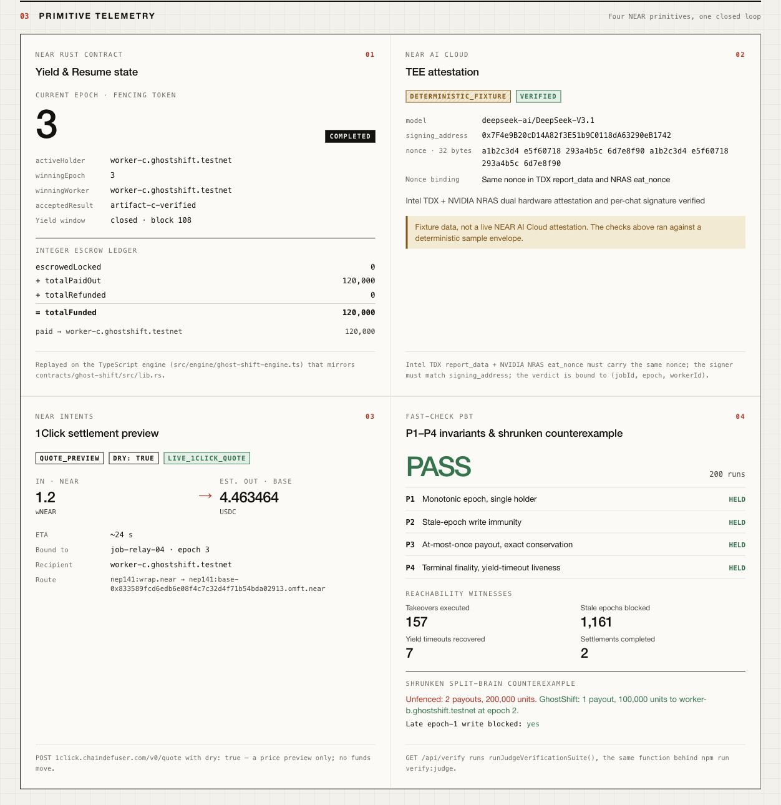

# GhostShift — NEAR 鏈上單調代次柵欄（Monotonic Epoch Fencing）與 Yield-Resume 任務交接審計台

[English](/README.md) | [繁體中文](/README.zh-TW.md)

為 **NEAR Hackathon 2026**（`https://nearhackathon.com/`）打造。

- **線上互動審計工作台**：[https://near-ghost-shift.vercel.app](https://near-ghost-shift.vercel.app)
- **公開 GitHub 儲存庫**：[https://github.com/GGGODLIN/near-ghost-shift](https://github.com/GGGODLIN/near-ghost-shift)
- **X（Twitter）演示貼文**：[https://x.com/GGGODLIN/status/2119075686073979332](https://x.com/GGGODLIN/status/2119075686073979332)
- **參賽賽道（Tracks）**：`security`（AI Security & Defense）、`swarms`（AI Swarms）、`agents`（Agent Economy）、`business`（Autonomous Business）、`open`（Open Innovation）、`privacy`（Privacy & Private AI）

> **雙案獨立揭露聲明（規則 `Q-015`）**：依 NEAR Hackathon 官方規則 `Q-015`（*"Allowed if projects are independent and disclosed: each README names the other project"*），本參賽者提交之兩個專案在賽道、問題空間與程式碼上 100% 獨立且零重疊：
> 1. **GhostShift**（本儲存庫）— 單調代次柵欄（Monotonic Epoch Fencing）與 `Yield & Resume` 任務交接審計台（賽道：`security`, `swarms`, `agents`, `business`, `open`, `privacy`）。
> 2. **[Afterlight](https://github.com/GGGODLIN/near-afterlight)**（[線上指揮艙 Demo](https://near-afterlight.vercel.app)）— 太空站長夜電網調度與 `NEP-171` 動態磨損設備 NFT 策略生存遊戲（賽道：`games`, `nfts`）。

https://github.com/user-attachments/assets/b7fae241-3a73-4ec9-8710-123b5c0832e1



---

## 解決什麼問題：失聯殭屍 Agent 醒來覆蓋接手者（Split-Brain 腦裂雙重付款）

在多 Agent 協作與自動化商務流程中，當原執行者 `worker-a.ghostshift.testnet` 在 `epoch = 1` 中途卡死逾時，備援者 `worker-b.ghostshift.testnet` 會接手過期租約繼續完成工作。然而卡死的 `worker-a` 常在幾秒後突然醒來，拿著仍然有效的舊金鑰送出過期結果或重播請款回呼。若鏈上沒有單調遞增的代次柵欄（`Epoch Fencing Token`）與非同步驗證閘門（`Yield & Resume`），`worker-a` 的遲到寫入就會覆蓋 `worker-b` 的成果，或造成託管賞金被重複發放兩次（`200,000` 單位雙重扣款）。

## 已部署的 NEAR Testnet 合約

合約：[ghostshift-v1-mwbxwes8.testnet](https://testnet.nearblocks.io/address/ghostshift-v1-mwbxwes8.testnet)。公開資料見 [deployment.ts](/src/near/deployment.ts)。

- [首次部署與初始化](https://testnet.nearblocks.io/txns/A86u6a5dhMu4H8WaV4x7UyVmC46pcnhjoRWxR8iyw45D)
- [目前 WASM 部署](https://testnet.nearblocks.io/txns/4qpfASRZYd15y18r9SyH2yrgJ1rxekPLKod4Za9N7YFC)
- [建立有賞金的工作](https://testnet.nearblocks.io/txns/8Sy7D4VjXVsrnBdHwdFzfrtXMwVXd14cRjdiMwfw2tkE)
- [領取 epoch 1 租約](https://testnet.nearblocks.io/txns/eEmePLjsar1Mos2u5SpAaTCzSAq3Uk2Bqbpq9MnggGq)
- [接手至 epoch 2](https://testnet.nearblocks.io/txns/uKYDX66zamiwNsbVUe6yuX7GKGmhSmeWFGzzKPd9omF)
- [攔截舊 epoch 1 心跳](https://testnet.nearblocks.io/txns/7Ji9FnjihtpMNxzTy4Emk68Jrdo5g4a58N9vFzY5YXgx)：這筆交易預期以 `StaleEpochRejected` 失敗。

`npm run verify:judge` 與 **Run judge check** 透過 RPC 在同一個已確認區塊讀取 `view_account`、`view_code`、`get_config`、`get_job`，比對已部署程式碼與示範工作代次。先探測舊端點；如果無法讀取，就改用 [FastNEAR Testnet](https://test.rpc.fastnear.com)，並在結果列出實際端點。如果兩個端點都失敗，鏈上檢查會失敗。

公開頁面清楚區分「即時鏈上合約狀態讀取 Live Testnet Read ＋ 瀏覽器安全沙盒模擬」：評審檢查讀真合約，情境按鈕在本地 TypeScript 引擎重播，不要求訪客提供錢包或私鑰。已公開的鏈上示範使用同一專用帳號領取與接手；不同 Worker 與結算競態由沙盒模擬。

## NEAR 整合與驗證邊界

1. **NEAR Rust 智能合約（[`contracts/ghost-shift/src/lib.rs`](/contracts/ghost-shift/src/lib.rs)，`near-sdk v5.30.1`）單調代次柵欄 ＋ `Yield & Resume`**：
   - 初次領取租約（`claim_lease`）設 `current_epoch = 1`；租約到期後每次接手（`takeover_lease`）將 `current_epoch` 嚴格遞增 `+1`。
   - 提交成果（`submit_result`）時呼叫 `env::promise_yield_create("on_verify_settled", ...)` 在鏈上暫停最長 200 個區塊，等待驗證者呼叫 `env::promise_yield_resume` 喚醒。
   - 任何帶 `epoch != current_epoch` 的心跳、提交或驗證回呼一律在鏈上入口被確定性攔截為 `StaleEpochRejected`（結算後則攔截為 `TerminalStateImmutable`）。
2. **階層式子帳號與受限 Function-Call Access Keys（[`src/engine/access-key-guard.ts`](/src/engine/access-key-guard.ts)）**：
   - 沙盒模擬只允許 `claim_lease`、`heartbeat`、`takeover_lease`、`submit_result` 的受限金鑰。情境 03 實際重播未授權 `resume_verify`；轉帳與 `AddKey` 有單元測試，但沒有各自的情境步驟。鏈上示範尚未建立獨立 Worker 子帳號或受限金鑰。
3. **有真實密碼學簽章的離線 TEE 形狀樣本（[`src/verifier/near-ai-tee.ts`](/src/verifier/near-ai-tee.ts)）**：
   - 用 `@noble/curves` 的 secp256k1 與 Keccak-256 還原 Ethereum `personal_sign` 簽章地址。簽章訊息綁定 `(jobId, epoch, workerId, nonceHex, model)`，還原地址必須符合固定樣本簽署者。訊息或簽章改一個位元組就驗證失敗。nonce 欄位只做一致性檢查，不代表已驗證 Intel／NVIDIA 硬體證明。
4. **NEAR Intents 1Click 跨鏈結算報價預覽（[`src/intents/oneclick-quote.ts`](/src/intents/oneclick-quote.ts)）**：
   - 針對唯一獲勝的 `(jobId, winningEpoch, winningWorker)` 向 `POST https://1click.chaindefuser.com/v0/quote`（`dry: true`, `swapType: "EXACT_INPUT"`）取得 `nep141:wrap.near` 兌換至 Base USDC 的真實跨鏈報價預覽。

---

## 評審 60 秒可重現驗證步驟（"Do X, See Y"）

### 步驟 1：執行 60 秒 AI 評審一鍵驗收套件（`Q-017`）
- **Do X**：
  ```bash
  npm install
  npm run verify:judge
  ```
- **See Y**：
  - 只有鏈上程式碼與狀態、本地 PBT、反例重播和簽章樣本檢查都通過，才印出 `verdict: "PASS"`。執行時間與結果受網路狀態影響。
  - 真實查詢 Testnet 合約，不再把搜尋 Rust 原始碼字串當作部署證據。
  - 透過 `fast-check` 執行 200 次隨機狀態機序列並以獨立事件預言機（`evaluateGhostShiftOracle`）逐步檢驗 `P1`（Epoch 單調遞增與單一持有者）、`P2`（舊代次寫入零污染）、`P3`（至多一次撥款與整數金額守恆）、`P4`（終態不可逆與 200 區塊逾時解鎖），同時觸發全部 4 項 Reachability Witnesses（`takeoverExecutedCount: 157`, `staleEpochBlockedCount: 1161`, `yieldTimeoutRecoveredCount: 7`, `completedSettlementCount: 2`）。
  - 重播 6 步最小腦裂反例並連通真實 `https://1click.chaindefuser.com/v0/quote` 取得即時報價。

### 步驟 2：執行完整單元測試與 Rust 合約型別檢查
- **Do X**：
  ```bash
  npm test
  PATH="$HOME/.cargo/bin:$PATH" RUSTFLAGS="--cfg near -C target-feature=-reference-types,-multivalue -C link-arg=-s" cargo build --release --locked --target wasm32-unknown-unknown --manifest-path contracts/ghost-shift/Cargo.toml --target-dir contracts/ghost-shift/target
  ```
- **See Y**：
  - 執行引擎、驗簽、RPC 與 API 測試，再用正確 NEAR 主機函式設定編譯可部署的 WASM。Node 測試以 `--test-concurrency=3` 限制同時執行的測試檔；不使用 Jest 專用的 `--maxWorkers`。

### 步驟 3：操作線上互動審計工作台
- **Do X**：
  開啟 [https://near-ghost-shift.vercel.app](https://near-ghost-shift.vercel.app)（或本機執行 `npm run dev` 開啟 `http://localhost:3000`）。
- **See Y**：
  - 一鍵切換 4 個預設情境並點擊右上角 **Run judge check**，檢視代次柵欄時間軸、無防護 vs. GhostShift 對照表、TEE 證明卡與 1Click 即時跨鏈報價。

## 信任與來源邊界

- **`DETERMINISTIC_SIGNED_FIXTURE`**：目前固定使用預先簽署的離線樣本，只保存訊息、簽章與公開地址。`LIVE_TEE` 保留給未來具完整硬體證據的整合，目前會被拒絕。設定 `NEAR_AI_API_KEY` 不會將樣本變成硬體證明。
- **合約信任**：`resume_verify` 信任初始化時設定的驗證者帳號與其 `tee_signer_verified` 判定，Rust 合約不自行還原 ECDSA 或驗證硬體證明。公開鏈上交易證明入金、領租約、接手與舊心跳攔截；yield/resume、撥款與逾時回復目前是本地模型檢查。
- **`QUOTE_PREVIEW`**：1Click 一律 `dry: true`，只預覽報價。API 成功標 `LIVE_1CLICK_QUOTE`，無法連線標 `FALLBACK_QUOTE_PREVIEW`。
- **外部副作用**：不檢查 epoch 的 Web2 API 必須自行做冪等處理；鏈上代次不保證任意外部服務只執行一次。




